<p align="center">
  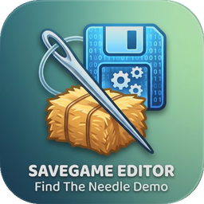
</p>

<h1 align="center">Find The Needle – Savegame Editor</h1>

<p align="center">
  Save editor for <b>Find The Needle Demo</b> (Steam, Godot 4).<br>
  One exe, dark UI, English and German, automatic backups – and a <b>haystack radar</b> that shows you where every needle is hidden.
</p>

<p align="center">
  <a href="../../releases/latest"></a>
  <a href="../../releases"></a>
  
  <a href="LICENSE"></a>
</p>

<p align="center">
  <a href="../../releases/latest"><b>⬇ Download FindTheNeedleEditor.exe</b></a>
</p>

<p align="center">
  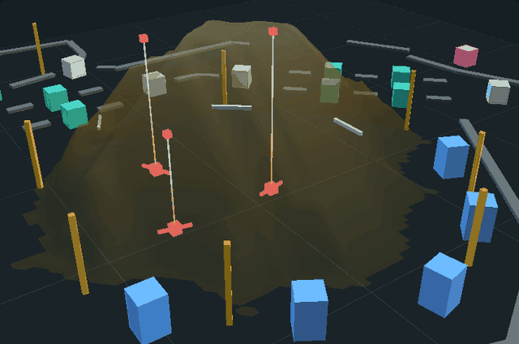
</p>

Unofficial fan tool, not affiliated with the developers of Find The Needle.

## 📡 Haystack radar

The pile in Find The Needle hides a handful of needles under metres of hay. The save stores the full height map of the pile and the exact position of every needle – the radar draws both.

| Top view | 3D view | 3D x-ray |
|----------|---------|----------|
| 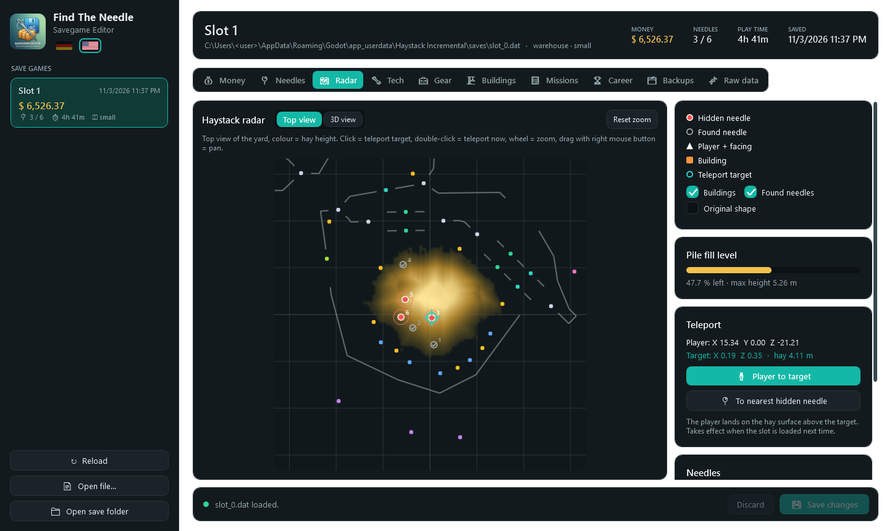 | 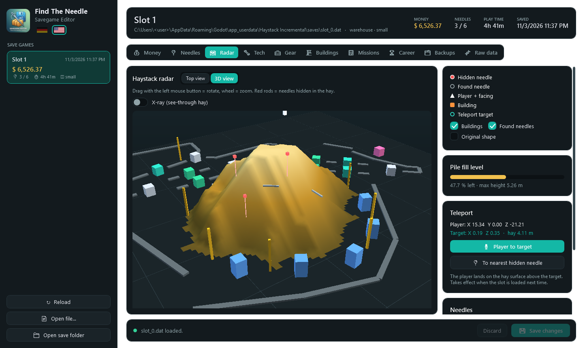 | 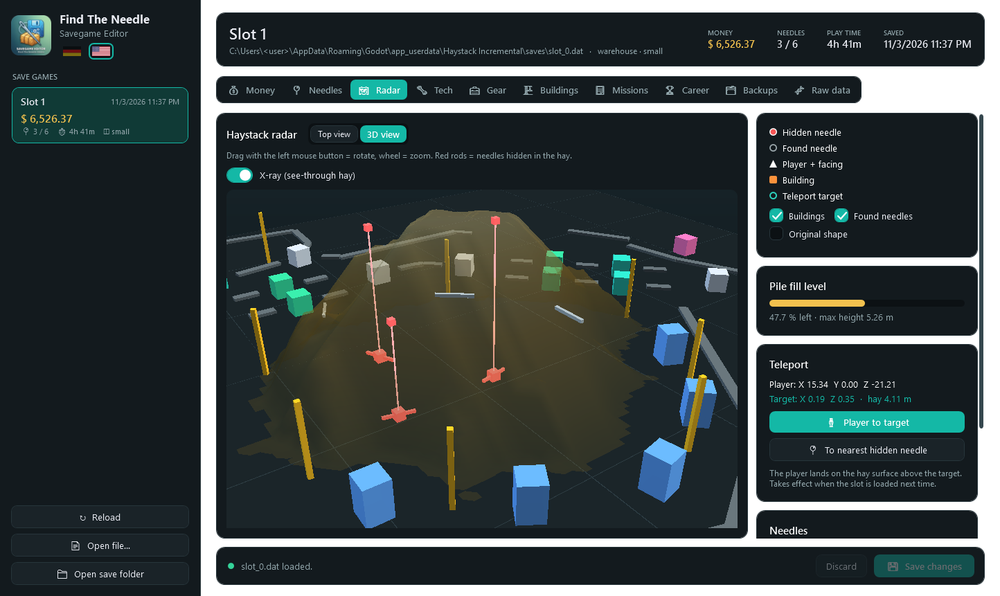 |

- **Top view**: hay height as a heat map, hidden needles (red), found needles (grey), every building, belts and the player with facing direction. Mouse wheel zooms, right mouse button pans.
- **3D view**: the pile as terrain with all machines around it. Drag to orbit, wheel to zoom.
- **X-ray**: makes the hay see-through. A red beacon rises from every hidden needle, so you see at a glance how deep it is buried.
- **Teleport**: click a spot to set a target, double-click to teleport there, or jump straight to the nearest hidden needle. The player is placed on the hay surface above it.
- Fill level of the pile, the original pile shape, and the hay depth above each needle.

## Features

| Tab | What you can change |
|-----|---------------------|
| **Money** | Balance with quick buttons (+1,000 … +1 M, ×2), clear debt, all run records as tiles (click to edit), jetpack fuel, radar cooldown, haystack counters, run flags |
| **Needles** | The needles hidden in the pile (position, hay above, mark as found – counted like in the game), the collection of all needle types (discovered, stock, total) |
| **Radar** | See above |
| **Tech** | Every upgrade as a tree per area (base tech → upgrades on top of it), ranks with −/+, unlock locked ones, search, all +1 / −1 / to rank X, unlock all known |
| **Gear** | Shop tools as clickable tiles, the build hotbar as keys 1–9, gifts waiting to be claimed, clear the "new" badges |
| **Buildings** | Overview (count, switched on, invested, total fuel), one card per building type with on/off switches, fuel bars, storage and tier; switch all on/off, refuel all generators |
| **Missions** | Current mission, contracts, done/paid lists as chips, spending analysis from the purchase log (by kind, biggest items) |
| **Career** | Records across all runs from `profile.cfg` (online identity and leaderboard data are never touched) |
| **Backups** | Automatic backup before every save, manual backup, restore any backup |
| **Raw data** | The complete save as a tree; every simple value can be edited. Export as JSON or decrypted `.bin`, import `.bin` |

| Money | Tech | Buildings |
|-------|------|-----------|
| 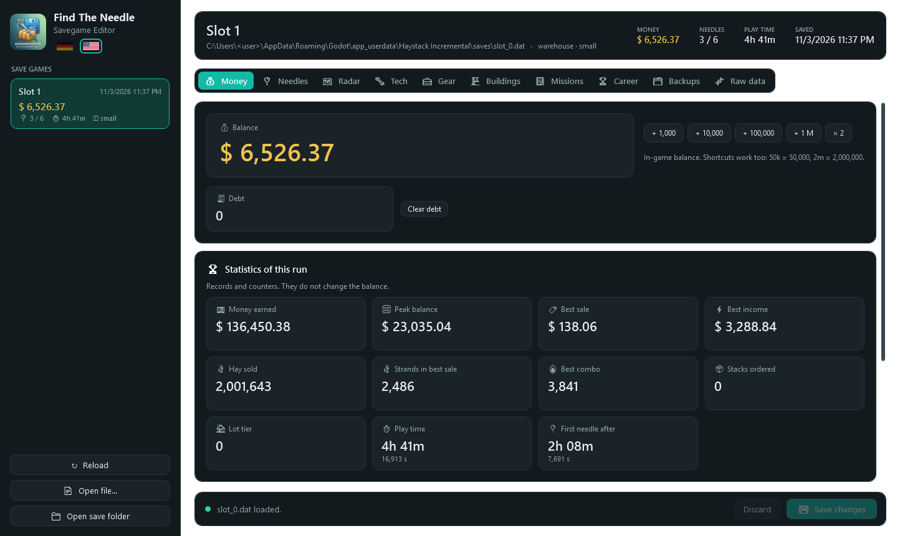 | 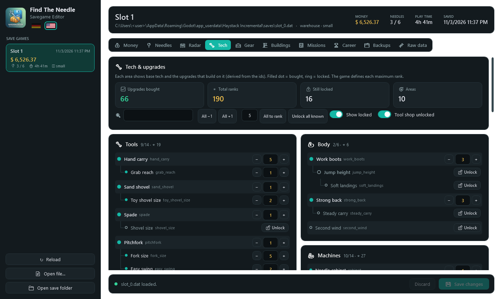 | 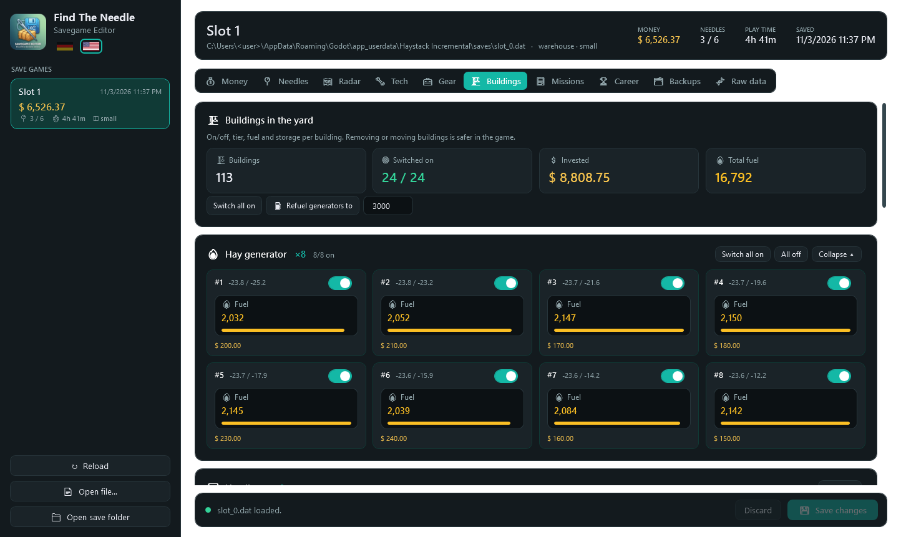 |

| Needles | Gear | Missions |
|---------|------|----------|
| 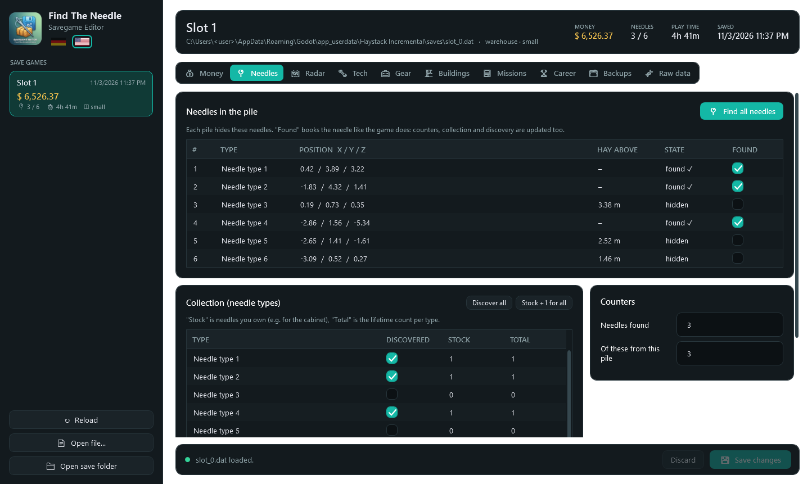 | 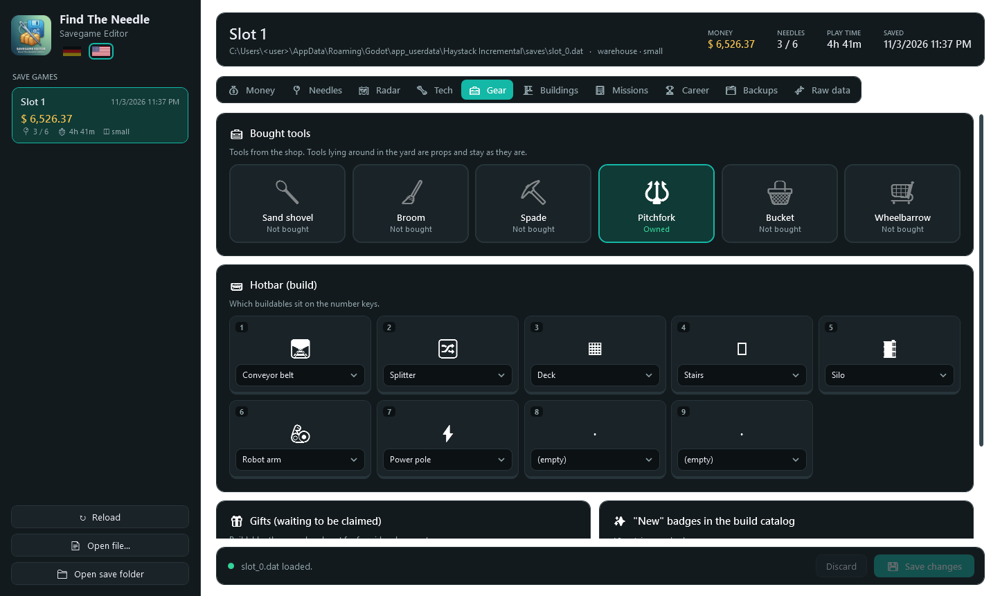 | 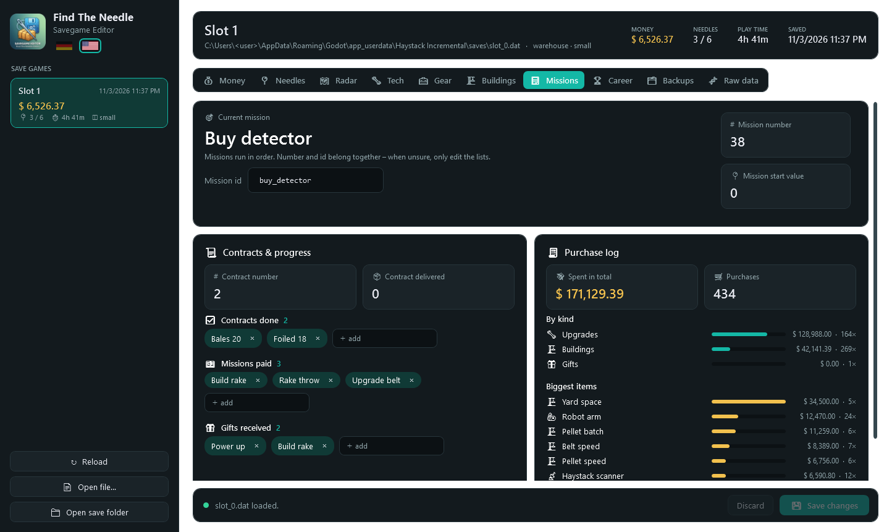 |

Also:

- Unchanged saves are written back byte for byte; every save is decrypted and parsed again before it is written
- Saving is locked while the game is running (its autosave would overwrite your changes)
- Refuses to overwrite a slot the game saved after the editor loaded it
- English by default, German via the flag in the sidebar (remembered)
- Single self-contained exe, no installation, no .NET runtime needed

## Usage

1. Download `FindTheNeedleEditor.exe` from the [latest release](../../releases/latest) (Windows 10/11 x64).
2. Close the game.
3. Start the editor, pick a slot, change what you want, click **Save changes**.

The saves are hard to find because the game calls itself "Haystack Incremental" internally:

```
%APPDATA%\Godot\app_userdata\Haystack Incremental\saves\slot_0.dat
%APPDATA%\Godot\app_userdata\Haystack Incremental\profile.cfg
```

Backups go to `…\Haystack Incremental\EditorBackups\`.

## Save format

```
"GDEC" | MD5(plain) 16 B | uint64 plain length | IV 16 B | AES-256-CFB(plain, zero padded)
key   = md5_text("b88b32d1fb83a23ac1facd11a612222774cca9aed41a87ed") as 32 ASCII chars
plain = Godot store_var: uint32 length + binary-serialized Variant (a Dictionary)
```

This is Godot's `FileAccess.open_encrypted_with_pass`. The password is a constant in the game's save script, so it is the same for every player. The dictionary holds `state` (money, needles, missions, …), `heights`/`dome` (121 × 121 height maps, 0.25 m cells), `player` (Transform3D), `buildings`, `props`, `belts`, `tech.ranks` and `meta` (main-menu preview).

If a game update ever changes the password, the sidebar shows **🔑 Find key**: start the game, load a save, click it. The editor tries every string in the game's memory as password, checks each hit against the file's MD5 and remembers the one that works.

## Build

```
cd src/FindTheNeedleEditor
dotnet publish -c Release -o ../../publish
```

Tests (round trip, and edit + save + reload on a **copy** of the save folder):

```
cd tests/RoundTrip
dotnet run -- "%APPDATA%\Godot\app_userdata\Haystack Incremental\saves\slot_0.dat"
dotnet run -- --edit <copy of the Haystack Incremental folder>
```

Command-line options of the editor, mainly for testing and screenshots:

| Option | Effect |
|--------|--------|
| `--root <folder>` | Use another "Haystack Incremental" folder (e.g. a copy) |
| `--lang en\|de` | Language for this run |
| `--mask-user` | Hide the Windows user name in displayed paths |
| `--snapshot <folder>` | Render every tab plus the radar views to PNG and exit |
| `--ignore-game` | Skip the running-game check |

## Layout

| Path | Purpose |
|------|---------|
| `src/FindTheNeedleEditor/Core/GVariant.cs` | Godot 4 Variant binary format (decode/encode) |
| `src/FindTheNeedleEditor/Core/SaveCrypto.cs`, `KeyFinder.cs` | GDEC encryption, key search in the running game |
| `src/FindTheNeedleEditor/Core/SaveDoc.cs`, `SaveStore.cs`, `ProfileCfg.cs` | Typed access to the save, slots, backups, safe writing, career file |
| `src/FindTheNeedleEditor/PileMap.cs`, `Pile3D.cs` | Radar top view and 3D view |
| `src/FindTheNeedleEditor/Pages.cs`, `TechPage.cs`, `UiKit.cs` | Tile-based pages |
| `tests/RoundTrip` | Round-trip, edit and key-finder checks |

See [CHANGELOG.md](CHANGELOG.md) for the version history.

## License

MIT, see [LICENSE](LICENSE).
